# Patient Management System (PMS) — Product Blueprint for Antigravity

> **Purpose:** Build a new, company-branded Patient Management System inspired by the supplied PMS reference screenshots. Use the screenshots to understand workflows and feature coverage; do not copy the old product's branding, logo, text, or visual styling.
>
> **Reference material reviewed:** `PMS.zip` — 46 screenshots across dashboard, patient registration/reporting, masters, registers, reports, settings, chat, backups, and user activity.

---

## 1. Product vision

Build a modern, secure, responsive, browser-based PMS for a hospital, clinic, pathology/diagnostic centre, or multi-branch healthcare organization.

The application should manage the operational lifecycle:

**Patient → Registration → Service/Investigation Selection → Billing/Charges → Sample or Visit Workflow (where applicable) → Report Preparation → Doctor Verification → Report Delivery → Follow-up and Audit**

The exact clinical workflow varies by company. Therefore, make service types, investigation catalogue, report templates, charge categories, departments, branches, and approval rules configurable instead of hard-coding one diagnostic centre's process.

### Product principles

1. **Company configurable:** company name, logo, contact details, branches, invoice/report branding, currency, timezone, and numbering formats must be configurable.
2. **Branch-aware:** every operational record must be associated with an organization and, where relevant, a branch.
3. **Role-based:** users see and perform only the actions granted to their role and permissions.
4. **Audit-ready:** sensitive changes, report verification, billing adjustments, permission changes, and record access should be traceable.
5. **Patient-centric:** one patient profile should provide a consolidated view of registration, visits/cases, investigations, payments, and reports.
6. **Responsive:** optimized for desktop front-desk use but usable on tablets.
7. **Extensible:** keep the architecture ready for later additions such as appointments, lab sample tracking, inventory, insurance, and integrations.

---

## 2. Recommended technology stack

Use a separate frontend and backend. This is a good fit because the reference application has many data-entry screens and reporting workflows, while Python will also make future OCR, document processing, and AI integrations easier.

| Layer | Recommended technology | Reason |
|---|---|---|
| Frontend | React + TypeScript + Vite | Component-based UI, strong ecosystem, fast development |
| UI styling | Tailwind CSS + shadcn/ui | Consistent modern admin interface and reusable accessible components |
| Forms | React Hook Form + Zod | Reliable form state and validation |
| Server state | TanStack Query | API caching, loading/error states, refetching |
| Tables | TanStack Table | Search, filters, sorting, pagination |
| Charts | Recharts | Dashboard and financial/report analytics |
| Backend | Python 3.12+ + FastAPI | Typed APIs, validation, async support, OpenAPI docs, Python ecosystem |
| ORM / migrations | SQLAlchemy 2 + Alembic | Maintainable relational data model and schema migrations |
| Database | PostgreSQL | Strong relational integrity, transactions, indexing, JSON support |
| Authentication | Secure session or short-lived JWT + refresh strategy | Secure login and controlled session lifecycle |
| Background jobs | Redis + Celery/RQ (add when needed) | Email, PDF generation, scheduled backups, long-running jobs |
| File storage | S3-compatible object storage or private local storage for development | Patient documents and generated reports should not be stored as public files |
| PDF | HTML templates + WeasyPrint or ReportLab | Branded receipts and patient reports |
| Deployment | Docker + Docker Compose; Nginx reverse proxy | Reproducible development and deployment |
| Testing | Pytest + HTTPX; Vitest + React Testing Library; Playwright | Backend, UI, and end-to-end coverage |

### Architecture recommendation

- Build a **modular monolith first**, not microservices. It is easier to build, test, deploy, and maintain for the first production version.
- Keep modules separated in code so they can be extracted later if scale requires it.
- Use PostgreSQL as the source of truth.
- Keep uploaded files in private storage; store only metadata and storage keys in PostgreSQL.
- Never expose database credentials, secret keys, or storage credentials in frontend code.
- Use environment variables and provide `.env.example`.

---

## 3. Application navigation / information architecture

Use a clean admin layout with a collapsible left sidebar, top header, breadcrumbs, global search, branch selector, notification area, and user profile menu.

Recommended sidebar:

1. **Dashboard**
2. **Patients**
   - Patient List
   - Register New Patient
   - Patient Profile
   - Patient Visits / Cases
3. **Services & Investigations**
   - Investigation Catalogue
   - Investigation Charges
   - Service Categories
   - Report Templates
4. **Billing**
   - New Bill / Charges
   - Payments
   - Outstanding Dues
   - Refunds / Adjustments
5. **Reports**
   - Patient Reports
   - Investigation / Charges Report
   - Other Charges Report
   - Referring Doctor Report
   - Reporting Doctor Report
   - Date-wise Report
6. **Registers**
   - Case Register
   - Bank Register
   - Expense Register
   - Petty Cash Register
7. **Master Data**
   - Branches
   - Departments
   - Cities / Locations
   - Patient Categories
   - Doctor Categories
   - Referring Doctors
   - Reporting Doctors
   - Other Charge Types
   - Email Templates
8. **Communication**
   - Internal Chat / Messages
   - Send Email
   - Notification Templates
9. **Administration**
   - Users
   - Roles & Permissions
   - General Settings
   - Numbering / Document Settings
   - Backup & Restore
   - User Activity / Audit Logs

Hide modules and actions the signed-in user is not authorized to access.

---

## 4. Main end-to-end workflow

```mermaid
flowchart TD
    A([User opens PMS]) --> B[Login]
    B --> C{Credentials valid?}
    C -- No --> B
    C -- Yes --> D[Load user role, permissions and assigned branch]
    D --> E[Dashboard]
    E --> F{Choose task}
    F --> G[Search existing patient]
    F --> H[Register new patient]
    G --> I{Patient found?}
    I -- Yes --> J[Open patient profile]
    I -- No --> H
    H --> K[Enter demographics and contact details]
    K --> L[Validate and create patient ID]
    L --> J
    J --> M[Create new visit / case]
    M --> N[Select referring doctor and reporting doctor]
    N --> O[Select investigations / services]
    O --> P[Add symptoms, clinical notes and attachments if applicable]
    P --> Q[Add other charges / discounts]
    Q --> R[Calculate bill and collect / record payment]
    R --> S[Create service work items]
    S --> T[Perform investigation / service]
    T --> U[Prepare report using configured template]
    U --> V[Save draft]
    V --> W[Authorized reviewer verifies report]
    W --> X{Approved?}
    X -- No --> U
    X -- Yes --> Y[Finalize and lock report version]
    Y --> Z[Generate branded PDF]
    Z --> AA[Deliver / print / securely share report]
    AA --> AB[Update patient timeline and audit log]
    AB --> AC([Workflow complete])
```



### Important workflow rules

- Search for an existing patient before creating a new one. Show possible duplicates using configurable matching rules such as phone number, date of birth, and name; never silently merge records.
- Generate a unique patient ID and a separate visit/case number.
- A patient may have multiple visits/cases; each case may contain multiple investigations/services.
- Billing totals must be calculated on the server. The browser may preview totals but must not be trusted as the final calculator.
- A report must have a status and version history. Only authorized users may verify/finalize it.
- Finalized reports must not be silently overwritten. Corrections should create a traceable amended version with reason, actor, and timestamp.
- Report delivery must be logged. Do not expose patient reports through guessable public URLs.
- Financial adjustments, refunds, and deletions require permissions and audit entries.

---

## 5. Module specifications

### 5.1 Authentication and dashboard

**Screens**
- Login, logout, forgot/reset password
- Dashboard with date range and branch filters
- User profile and change password

**Dashboard cards / charts**
- Total patients
- New registrations today / this month
- Total cases/visits
- Pending investigations/services
- Reports pending preparation
- Reports pending verification
- Reports finalized
- Today's collections
- Outstanding dues
- Expenses
- Revenue / collection trend
- Recent activity

All dashboard values must respect user permissions and branch scope. Do not show financial cards to roles that lack financial access.

### 5.2 Patient management

**Patient registration fields (configurable where appropriate)**
- Patient ID (system-generated)
- Full name
- Date of birth or age (avoid storing both inconsistently; define one canonical approach)
- Gender / sex field according to the company's operational requirements
- Mobile number
- Email (optional)
- Address
- City / state / postal code
- Emergency contact (optional)
- Patient category
- Notes
- Consent / privacy acknowledgement where required

**Patient list**
- Search by patient ID, name, phone, or case number
- Filters by branch, category, registration date, and status
- Pagination, sorting, export permission, and column selection

**Patient profile tabs**
- Overview
- Visits / Cases
- Investigations / Services
- Billing & Payments (permission-controlled)
- Reports & Documents
- Timeline / Activity

### 5.3 Visit / case management

A visit/case groups the work done for a patient on a particular encounter.

Fields:
- Case number
- Patient ID
- Branch
- Visit date/time
- Referring doctor
- Reporting / assigned doctor
- Department
- Symptoms / notes
- Priority
- Status
- Created by / timestamps

Suggested statuses: `draft`, `registered`, `awaiting_payment`, `in_progress`, `report_pending`, `verification_pending`, `completed`, `cancelled`.

Allow status configuration only where it will not break the core workflow.

### 5.4 Investigation and service catalogue

- Investigation/service master
- Category and department
- Code
- Display name
- Description
- Default price
- Expected turnaround time (optional)
- Active/inactive
- Report template mapping
- Branch availability
- Preparation instructions (optional)

Support both diagnostic investigations and non-diagnostic services. Do not assume every service requires a medical report.

### 5.5 New patient / case wizard

The reference screenshots show a multi-step new-patient flow. Implement it as a clear wizard with a progress indicator:

1. Patient details — select existing patient or register new
2. Investigation / service selection
3. Referring doctor
4. Reporting doctor / department
5. Symptoms and notes
6. Other charges / discount
7. Review, bill, and payment
8. Confirmation and case summary

Requirements:
- Save draft and resume later.
- Previous/Next navigation must preserve entered data.
- Validate each step before continuing.
- Show a final review screen before committing.
- Avoid duplicate case creation on double-click or retry.
- Support adding/removing multiple investigations and charges.

### 5.6 Billing and payments

- Generate invoice/receipt number.
- Support configurable tax fields only if required by the company.
- Support payment modes such as cash, card, UPI, bank transfer, and other configurable modes.
- Allow split payments if required.
- Track paid, partial, due, refunded, and cancelled states.
- Record discount reason and approving user.
- Maintain a payment ledger; do not overwrite payment history.
- Generate printable PDF receipt.
- Reconcile cash/bank collections with financial registers.

### 5.7 Report preparation and verification

Reference screenshots show a report editor with a selectable investigation tree, report name/heading, and rich-text editor.

Implement:
- Investigation-specific report templates.
- Structured fields where possible (e.g. observations, measurements, impression/conclusion).
- Rich-text editor only where free-form content is required.
- Attach images/documents when applicable.
- Draft, submitted-for-review, returned-for-correction, verified, finalized, and amended statuses.
- Reviewer identity, timestamp, and optional remarks.
- Version history and change reason.
- Branded PDF with company logo, branch details, patient/case details, report content, authorized sign-off fields, and page numbering.
- Print and secure delivery actions.

**Clinical safety:** this is an operational record and report workflow. Do not generate diagnoses, clinical interpretations, or treatment recommendations with AI by default. Any future AI assistance must be optional, clearly labelled, reviewed by an authorized professional, and never auto-finalize a clinical report.

### 5.8 Reports and analytics

Provide filter panels with date range, branch, department, doctor, category, status, and service/investigation filters as relevant.

Required reports based on screenshots:
- Patient report / patient register
- Investigation charges report
- Other charges report
- Referring doctor report
- Reporting doctor report
- Date-wise register/report
- Case register
- Collection summary
- Expense report
- Outstanding dues

Every report should support:
- Search, sort, pagination
- On-screen summary totals where relevant
- Export to CSV/XLSX only for authorized users
- PDF print/export where appropriate
- Filter persistence during navigation
- Clear empty/loading/error states

### 5.9 Financial registers

- Bank register
- Case register
- Date-wise register
- Expense register
- Petty cash register

Use append-only financial transaction records wherever possible. Corrections should be represented as reversal/adjustment entries, not destructive edits. Restrict access to finance roles.

### 5.10 Master data

Build reusable CRUD screens for:
- Branch
- Department
- City / location
- Patient category
- Doctor category
- Referring doctor
- Reporting doctor
- Investigation/service
- Investigation charges
- Other charge types
- Email templates

Each master should support validation, active/inactive status, search, pagination, and audit history. Prevent deletion when a master is already referenced by operational records; allow deactivation instead.

### 5.11 Users, roles, and permissions

Start with configurable roles such as:
- Super Admin
- Organization Admin
- Branch Admin
- Receptionist
- Billing Executive
- Technician / Service Operator
- Report Writer
- Reporting Doctor / Reviewer
- Accountant
- Read-only Auditor

Permissions should be granular:
- Module access
- View / create / update / deactivate
- Verify / finalize report
- Collect payment / issue refund
- View financial data
- Export data
- Manage users and settings
- View audit logs

Enforce permissions in the backend on every protected endpoint, not only by hiding frontend buttons.

### 5.12 Communication

- Internal chat or message centre (as shown in the reference screenshots)
- User-to-user messages
- Read/unread state
- Email composition and template management
- Email delivery status and failure log
- Notifications for pending verification, report completion, payment due, and other configured events

Use a background job for email sending. Never block a patient registration request while an email provider is responding.

### 5.13 Settings, backup, and audit

**General settings**
- Organization profile and branding
- Branch configuration
- Timezone and date format
- Currency and number formats
- Patient/case/invoice numbering patterns
- Report and receipt templates
- Email configuration
- Security/session policy

**Backup**
- Database backup schedule and retention policy
- Private file-storage backup
- Backup history and status
- Restore procedure restricted to authorized administrators
- Test restore process before production use

**Audit log**
- User login/logout
- Create/update/deactivate actions on important records
- Report review/finalization/amendment
- Payment/refund/discount actions
- Permission and settings changes
- Data exports
- Record ID, actor, timestamp, branch, action, and relevant before/after metadata (avoid copying unnecessary sensitive patient content into logs)

---

## 6. Core data model

Use UUID primary keys. Include `organization_id` on organization-owned data and `branch_id` on branch-scoped operational data. Add `created_at`, `updated_at`, `created_by`, and `updated_by` where appropriate.

Suggested tables / entities:

### Organization and access
- `organizations`
- `branches`
- `users`
- `roles`
- `permissions`
- `role_permissions`
- `user_roles`
- `user_branch_access`
- `sessions` or refresh-token/session records
- `audit_logs`

### Patient and clinical operations
- `patients`
- `patient_contacts` (optional if multiple contacts are needed)
- `patient_consents`
- `visits` or `cases`
- `departments`
- `doctor_categories`
- `doctors`
- `case_doctors` (if multiple doctor assignments are needed)
- `patient_symptoms` or case notes
- `investigation_categories`
- `investigations`
- `investigation_branch_prices`
- `case_items` (one row per investigation/service in a case)
- `service_work_items` (optional, if operational tracking needs a separate lifecycle)
- `report_templates`
- `reports`
- `report_versions`
- `report_attachments`
- `report_deliveries`

### Billing and finance
- `invoices`
- `invoice_items`
- `payments`
- `payment_allocations` (if split/partial payment allocation is needed)
- `refunds`
- `discounts`
- `other_charge_types`
- `expenses`
- `bank_transactions`
- `petty_cash_transactions`
- `financial_register_entries`

### Communication and system
- `email_templates`
- `email_logs`
- `messages`
- `message_reads`
- `notifications`
- `file_objects`
- `backup_jobs`
- `system_settings`
- `number_sequences`

Use foreign keys, unique constraints, check constraints, and indexes. Define deletion and retention rules before production. Do not store uploaded file binaries in database columns unless there is a compelling reason.

---

## 7. API structure

Use versioned REST endpoints under `/api/v1`.

Example route groups:

```text
/api/v1/auth
/api/v1/organizations
/api/v1/branches
/api/v1/users
/api/v1/roles
/api/v1/permissions
/api/v1/dashboard

/api/v1/patients
/api/v1/patients/{patient_id}/timeline
/api/v1/cases
/api/v1/cases/{case_id}/items
/api/v1/investigations
/api/v1/departments
/api/v1/doctors
/api/v1/report-templates
/api/v1/reports
/api/v1/reports/{report_id}/submit
/api/v1/reports/{report_id}/verify
/api/v1/reports/{report_id}/finalize
/api/v1/reports/{report_id}/versions

/api/v1/invoices
/api/v1/payments
/api/v1/refunds
/api/v1/expenses
/api/v1/registers

/api/v1/analytics
/api/v1/email-templates
/api/v1/messages
/api/v1/notifications
/api/v1/settings
/api/v1/audit-logs
/api/v1/backups
```

API requirements:
- Pydantic request/response schemas.
- Consistent error response format.
- Pagination and server-side filtering for list endpoints.
- Database transactions for case creation, invoice creation, and payment allocation.
- Idempotency protection for payment and case-creation operations where retries could duplicate records.
- OpenAPI documentation.
- Backend authorization and organization/branch scoping on every relevant query.

---

## 8. Security, privacy, and reliability requirements

Patient information is sensitive. Treat security as a core feature, not a later enhancement.

- HTTPS in every deployed environment.
- Secure password hashing (Argon2id or bcrypt with appropriate parameters).
- Secure, HttpOnly, SameSite cookies if cookie-based authentication is used.
- CSRF protection where cookie-based authentication requires it.
- Rate limiting for login and sensitive endpoints.
- Strict server-side validation and output encoding.
- Organization and branch data isolation.
- Least-privilege roles and permissions.
- Private file storage and short-lived signed download links.
- File type/size validation and malware scanning where available.
- Audit logs for sensitive operations.
- Encrypted backups and protected secrets.
- No patient data, passwords, tokens, or API keys in application logs.
- Configurable retention and deletion policy.
- Follow applicable Indian data-protection and healthcare requirements; obtain qualified legal/compliance review before production deployment.
- Do not use real patient data in development or demo screenshots. Use synthetic test data.

---

## 9. Suggested project structure

```text
pms/
├── frontend/
│   ├── src/
│   │   ├── app/
│   │   ├── components/
│   │   ├── layouts/
│   │   ├── features/
│   │   │   ├── auth/
│   │   │   ├── dashboard/
│   │   │   ├── patients/
│   │   │   ├── cases/
│   │   │   ├── investigations/
│   │   │   ├── billing/
│   │   │   ├── reports/
│   │   │   ├── registers/
│   │   │   ├── masters/
│   │   │   ├── users/
│   │   │   ├── communication/
│   │   │   └── settings/
│   │   ├── hooks/
│   │   ├── lib/
│   │   ├── routes/
│   │   ├── types/
│   │   └── main.tsx
│   ├── package.json
│   └── .env.example
├── backend/
│   ├── app/
│   │   ├── api/v1/
│   │   ├── core/
│   │   ├── db/
│   │   ├── models/
│   │   ├── schemas/
│   │   ├── services/
│   │   ├── repositories/
│   │   ├── permissions/
│   │   ├── tasks/
│   │   └── main.py
│   ├── alembic/
│   ├── tests/
│   ├── pyproject.toml
│   └── .env.example
├── storage/                 # local development only; never expose publicly
├── docs/
│   ├── application-flow.md
│   └── api-notes.md
├── docker-compose.yml
├── .env.example
└── README.md
```

---

## 10. UI / UX direction

The supplied screenshots use a legacy admin layout with a narrow left icon bar, pale background, compact tables, and blue action buttons. Preserve the useful information architecture but redesign the interface.

Recommended design:
- Professional healthcare SaaS look.
- Light theme by default, with a restrained navy/blue/teal accent palette.
- Left sidebar with icons and readable labels.
- Top bar with global patient search, branch selector, notifications, and profile.
- Clear page title, breadcrumb, primary action, and filter panel.
- Cards for dashboard KPIs; avoid excessive gradients and decorative charts.
- Tables with readable spacing, sticky headers, pagination, and row actions.
- Forms grouped into logical sections with labels, helper text, validation, and save/cancel actions.
- Multi-step case wizard with visible progress and a persistent summary panel.
- Report editor with template selector, structured sections, autosave draft indicator, and review status.
- Confirmation dialogs for destructive or financial actions.
- Toasts for success/failure and clear empty/loading/error states.
- Responsive sidebar and forms for tablet widths.
- Accessibility: keyboard navigation, visible focus, semantic labels, sufficient contrast.

Do not copy the reference company's logo, name, marketing text, or exact brand identity. Use a neutral placeholder organization identity until the new company's branding is supplied.

---

## 11. Implementation roadmap for Antigravity

Build incrementally. Do not generate the entire application in one unreviewed pass.

### Phase 0 — Discovery and project foundation
- Inspect this specification and the supplied screenshot references.
- Create the repository structure.
- Configure frontend, backend, PostgreSQL, Docker Compose, environment files, linting, and formatting.
- Create a design system and shared layout.
- Add README with setup instructions.

**Exit criteria:** both frontend and backend start locally; database connects; health endpoint works.

### Phase 1 — Authentication, organization, branches, and RBAC
- Login/logout and session handling.
- Organization and branch settings.
- Users, roles, permissions, branch access.
- Protected frontend routes and backend authorization.

**Exit criteria:** users with different roles see and access only authorized modules and branches.

### Phase 2 — Master data
- Departments, cities, categories, doctors, investigations/services, charge types, report templates.
- CRUD, validation, search, pagination, active/inactive state.

**Exit criteria:** operational forms can select valid master records.

### Phase 3 — Patient and case workflow
- Patient search and registration.
- Duplicate warnings.
- Patient profile and timeline.
- Case creation wizard.
- Investigation/service selection, doctor assignment, symptoms/notes, other charges.

**Exit criteria:** a receptionist can register a patient and create a case with multiple items without duplicate records.

### Phase 4 — Billing and financial registers
- Invoice calculation and receipt.
- Cash/UPI/card/bank payment modes.
- Partial payments, outstanding dues, discounts, refunds with permissions.
- Case, bank, expense, petty cash, and date-wise registers.

**Exit criteria:** server-calculated invoice and payment ledger reconcile correctly.

### Phase 5 — Reports and report verification
- Template-driven report editor.
- Draft and review workflow.
- Version history, verification, finalization, amendment.
- Branded PDF and secure delivery log.

**Exit criteria:** only authorized reviewers can finalize; finalized versions remain traceable.

### Phase 6 — Analytics, communication, and audit
- Dashboard and filtered reports.
- Email templates and background delivery.
- Internal chat/messages and notifications.
- Audit log and user activity screen.

**Exit criteria:** reports match underlying records and important actions are auditable.

### Phase 7 — Backup, hardening, and deployment
- Automated database and file backups.
- Restore test.
- Security review, automated tests, performance checks.
- Production Docker deployment, HTTPS, monitoring, and operator documentation.

**Exit criteria:** tested deployment and documented recovery procedure.

---

## 12. Minimum acceptance test scenarios

1. A receptionist cannot view admin settings or user permissions.
2. A branch user cannot access another branch's patients by changing an ID in the URL or API request.
3. Registering a patient creates one unique patient ID.
4. Searching an existing patient warns about possible duplicates.
5. One patient can have multiple cases.
6. One case can contain multiple investigations/services.
7. Invoice totals are recalculated and validated by the backend.
8. Partial payments correctly update the outstanding balance.
9. A user without refund permission cannot issue a refund.
10. A report writer can save a draft but cannot finalize it without reviewer permission.
11. A reviewer can return a report for correction or finalize it.
12. An amended report retains the prior finalized version and records the reason.
13. A report download is authorized and logged.
14. Deactivating a doctor or investigation does not break historical cases.
15. Financial registers reconcile with invoices, payments, refunds, and expenses.
16. Exports respect the user's branch and permission scope.
17. Backup and restore are tested using a non-production dataset.
18. All screens work at desktop and tablet widths.

---

## 13. Screenshot reference index

The archive contains the following reference groups. Use them to validate feature coverage:

| Screenshot group | Reference files / feature represented |
|---|---|
| Marketing / product pages | `Front_Page.png`, `Front_Page2.png`, `Front_Page3.png` |
| Dashboard | `PMS_Dashboard.png` |
| Patient registration and workflow | `New_Patient.png`, `PMS_Patient_Registration.png`, `Investigation.png`, `Reporting_Doctor.png`, `Symtoms.png`, `Other_Charges.png` |
| Patient records and reports | `Patient_Record.png`, `Patient_Report.png`, `Patient_Report_Main.png`, `Pateint_Report_Main2.png`, `Pateint_Report_Main3.png` |
| Charge reports | `Charges_Report.png`, `Other_Charges_Report.png`, `New_Tab.png`, `New_tab2.png` |
| Master data | `Add_New.png`, `Branch.png`, `Category.png`, `City.png`, `Department.png`, `Doctor_Category.png`, `Investigation_Charges.png`, `Investigation_Master.png`, `Pateint_Master.png`, `Add_Refer_Doctor.png`, `Add_Reporting_Doctor.png` |
| User administration | `Users.png`, `Permission.png` |
| Doctor reports | `refering_doctor_report.png`, `report_doctor_report.png` |
| Financial registers | `bank_register.png`, `case_register.png`, `date_wise_register.png`, `expense_register.png`, `petty_cash.png` |
| Communication | `seventh_tab_chat.png`, `send_email.png`, `email_template.png` |
| Settings and operations | `general_settings.png`, `eight_tab_create_backups.png`, `nineth_tab_user_activity.png`, `graph.png` |

Some screenshot labels contain spelling variations. Use clean, consistent names in the new product.

---

## 14. Master prompt for Antigravity

Copy the following instructions into Antigravity after adding this Markdown file and the original `PMS.zip` to the workspace:

> You are the lead product architect and senior full-stack engineer. Build the Patient Management System described in `PMS-APPLICATION-BLUEPRINT.md`. The supplied `PMS.zip` contains reference screenshots; inspect them when implementing each relevant module.
>
> **Mandatory technology choices:** React + TypeScript + Vite + Tailwind CSS + shadcn/ui on the frontend; Python FastAPI + SQLAlchemy 2 + Alembic on the backend; PostgreSQL as the database; Docker Compose for local infrastructure.
>
> First, inspect the repository and the reference screenshots. Then create an implementation plan and the project foundation. Do not skip architecture, data modelling, authorization, validation, or tests. Implement the roadmap phase by phase. At the end of each phase, run relevant tests, fix errors, and update the README and progress checklist.
>
> Build a genuinely working application, not a static mockup. Every visible button, form, table action, filter, navigation item, and workflow transition must have a defined behavior. Connect screens to real backend APIs and PostgreSQL. Do not use hard-coded demo arrays as the final data source. Seed only clearly identified synthetic development data.
>
> Keep organization and branch scoping enforced on the backend. Implement granular RBAC on every protected API. Treat patient information as sensitive. Use private file storage, audit logs, safe report versioning, secure authentication, and server-side financial calculations.
>
> Use a modern, clean healthcare SaaS interface. Do not copy the old product's logo, brand, marketing copy, or exact styling. Keep company identity and report branding configurable.
>
> Before coding each module, explain which reference screenshots it corresponds to, the user journey, the database entities, the API endpoints, and the acceptance tests. Prefer reusable components and consistent design tokens. Add loading, empty, error, validation, and success states.
>
> Do not invent clinical requirements. Make uncertain fields and workflow rules configurable and list open questions in `docs/open-questions.md`. Never let AI automatically diagnose, approve, or finalize a medical report.
>
> Start with Phase 0 and Phase 1 only. Show the planned file structure and database design first. Wait for review before proceeding to the next phases unless explicitly instructed to continue.

---

## 15. Decisions to confirm before production

The blueprint intentionally keeps these business-specific choices configurable. Confirm them with the company before go-live:

- Is this a hospital, clinic, pathology lab, radiology centre, or a combined diagnostic centre?
- Is the system for one organization with multiple branches, or a SaaS platform serving multiple unrelated companies?
- Which patient identity fields are mandatory?
- Which investigations/services and report templates are required?
- Who can write, verify, amend, and release reports?
- Is sample collection / lab processing / equipment workflow required?
- Which payment modes, taxes, invoice formats, and refund rules apply?
- Which email/SMS/WhatsApp provider will be used?
- What are the required backup retention, hosting, and compliance policies?

**Recommended starting scope:** deliver a secure single-organization, multi-branch PMS with configurable masters and roles. Keep `organization_id` in the data model so a future multi-tenant SaaS expansion remains possible, but do not add unnecessary multi-tenant billing or platform administration until the business requires it.
