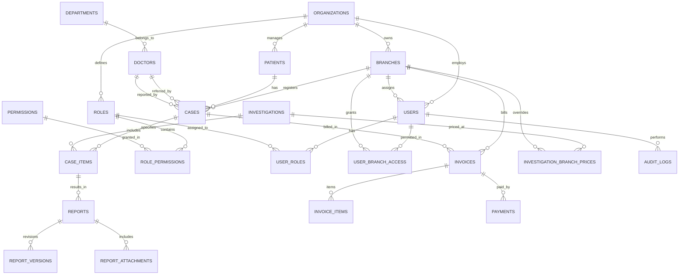

# Patient Management System (PMS) — Complete Database Design

This specification defines the complete relational schema for the Patient Management System in PostgreSQL using SQLAlchemy 2. All primary keys are UUIDs (`uuid_generate_v4()` / Python `uuid.uuid4`). Multi-tenancy and branch scoping are enforced by `organization_id` and `branch_id` foreign keys with database indexes.

---

## 1. Entity Relationship Overview

---

## 2. Table Specifications

### 2.1 Access Control & Organization (Phase 1 Core)

#### `organizations`
Multi-tenant root entity.
| Column | Type | Constraints | Description |
|---|---|---|---|
| `id` | UUID | PK | Unique organization ID |
| `name` | VARCHAR(255) | NOT NULL | Organization legal/commercial name |
| `code` | VARCHAR(50) | UNIQUE, NOT NULL | Short code (e.g. `MEDICARE`) |
| `logo_url` | VARCHAR(1024) | NULL | Uploaded organization logo URL |
| `favicon_url` | VARCHAR(1024) | NULL | Uploaded favicon URL |
| `contact_email`| VARCHAR(255) | NULL | Primary contact email |
| `contact_phone`| VARCHAR(50) | NULL | Primary contact phone |
| `website` | VARCHAR(255) | NULL | Organization website |
| `currency_code`| VARCHAR(10) | DEFAULT 'INR' | Default operational currency |
| `currency_symbol`| VARCHAR(10) | DEFAULT '₹' | Display currency symbol |
| `timezone` | VARCHAR(50) | DEFAULT 'Asia/Kolkata' | Organization timezone |
| `date_format` | VARCHAR(30) | DEFAULT 'DD/MM/YYYY' | Formatted display preference |
| `is_active` | BOOLEAN | DEFAULT TRUE | Active flag |
| `created_at` | TIMESTAMPTZ | DEFAULT NOW() | Creation timestamp |
| `updated_at` | TIMESTAMPTZ | DEFAULT NOW() | Last update timestamp |

#### `branches`
Physical centers / locations where patients visit and services occur.
| Column | Type | Constraints | Description |
|---|---|---|---|
| `id` | UUID | PK | Unique branch ID |
| `organization_id`| UUID | FK(organizations.id), INDEX | Parent organization |
| `branch_code` | VARCHAR(50) | NOT NULL | Sequential or custom code (e.g. `BR-01`) |
| `name` | VARCHAR(255) | NOT NULL | Branch name (e.g. `Vadodara Imaging Centre`) |
| `country` | VARCHAR(100) | NOT NULL | Country name |
| `state` | VARCHAR(100) | NOT NULL | State / Province |
| `city` | VARCHAR(100) | NOT NULL | City name |
| `address` | TEXT | NULL | Full physical address |
| `phone` | VARCHAR(50) | NULL | Branch frontdesk telephone |
| `email` | VARCHAR(255) | NULL | Branch email |
| `is_active` | BOOLEAN | DEFAULT TRUE | Active status |
| `created_at` | TIMESTAMPTZ | DEFAULT NOW() | Creation timestamp |
| `updated_at` | TIMESTAMPTZ | DEFAULT NOW() | Last update timestamp |

#### `users`
System operators across front desk, accounts, doctors, technicians, and administrators.
| Column | Type | Constraints | Description |
|---|---|---|---|
| `id` | UUID | PK | Unique user ID |
| `organization_id`| UUID | FK(organizations.id), INDEX | Parent organization |
| `default_branch_id`| UUID | FK(branches.id), NULL | Primary home branch |
| `username` | VARCHAR(100) | UNIQUE, NOT NULL | Login username |
| `email` | VARCHAR(255) | UNIQUE, NOT NULL | Login/Notification email |
| `full_name` | VARCHAR(255) | NOT NULL | Display name |
| `password_hash` | VARCHAR(255) | NOT NULL | Argon2id/Bcrypt hash |
| `phone` | VARCHAR(50) | NULL | Contact mobile number |
| `avatar_url` | VARCHAR(1024) | NULL | User avatar image URL |
| `is_email_verified`| BOOLEAN | DEFAULT FALSE | Email verification flag |
| `is_active` | BOOLEAN | DEFAULT TRUE | Account enabled flag |
| `is_superadmin`| BOOLEAN | DEFAULT FALSE | Global superuser flag |
| `last_login_at`| TIMESTAMPTZ | NULL | Timestamp of last successful login |
| `created_at` | TIMESTAMPTZ | DEFAULT NOW() | Creation timestamp |
| `updated_at` | TIMESTAMPTZ | DEFAULT NOW() | Last update timestamp |

#### `roles`
Configurable operational roles.
| Column | Type | Constraints | Description |
|---|---|---|---|
| `id` | UUID | PK | Unique role ID |
| `organization_id`| UUID | FK(organizations.id), NULL | Org-scoped or global system role |
| `name` | VARCHAR(100) | NOT NULL | Role name (e.g. `Receptionist`, `Reporting Doctor`) |
| `slug` | VARCHAR(100) | NOT NULL | Normalized slug (e.g. `receptionist`) |
| `description` | TEXT | NULL | Role explanation |
| `is_system` | BOOLEAN | DEFAULT FALSE | System-reserved non-deletable role |
| `created_at` | TIMESTAMPTZ | DEFAULT NOW() | Timestamp |

#### `permissions`
Atomic permission capabilities matching `Permission.png`.
| Column | Type | Constraints | Description |
|---|---|---|---|
| `id` | UUID | PK | Unique permission ID |
| `module` | VARCHAR(100) | NOT NULL | Target module (e.g. `patient_registration`, `billing`) |
| `action` | VARCHAR(50) | NOT NULL | Action (`view`, `add`, `update`, `delete`, `export`, `print`) |
| `code` | VARCHAR(150) | UNIQUE, NOT NULL | Combined slug (e.g. `patient_registration:add`) |
| `description` | TEXT | NULL | Description of permitted action |

#### `role_permissions`
Join table mapping roles to authorized permissions.
| Column | Type | Constraints | Description |
|---|---|---|---|
| `role_id` | UUID | FK(roles.id), PK | Target role |
| `permission_id`| UUID | FK(permissions.id), PK | Target permission |

#### `user_roles`
Join table mapping users to assigned roles.
| Column | Type | Constraints | Description |
|---|---|---|---|
| `user_id` | UUID | FK(users.id), PK | User |
| `role_id` | UUID | FK(roles.id), PK | Role |

#### `user_branch_access`
Explicit authorization list of branches an operator can access.
| Column | Type | Constraints | Description |
|---|---|---|---|
| `user_id` | UUID | FK(users.id), PK | User |
| `branch_id` | UUID | FK(branches.id), PK | Branch |
| `is_default` | BOOLEAN | DEFAULT FALSE | Indicates default active branch |

#### `audit_logs`
Immutable audit trail for compliance, forensic tracing, and security.
| Column | Type | Constraints | Description |
|---|---|---|---|
| `id` | UUID | PK | Unique audit log ID |
| `organization_id`| UUID | FK(organizations.id), INDEX | Organization context |
| `branch_id` | UUID | FK(branches.id), NULL, INDEX | Branch context |
| `user_id` | UUID | FK(users.id), NULL, INDEX | Acting user |
| `action` | VARCHAR(100) | NOT NULL | Action name (e.g. `AUTH_LOGIN`, `USER_CREATE`) |
| `entity_type` | VARCHAR(100) | NOT NULL | Entity modified (e.g. `user`, `case`, `report`) |
| `entity_id` | VARCHAR(100) | NULL | Primary key of modified entity |
| `ip_address` | VARCHAR(45) | NULL | Client IP address |
| `user_agent` | VARCHAR(500) | NULL | Browser user agent |
| `changes_json` | JSONB | NULL | Diff of changed fields (no sensitive data) |
| `created_at` | TIMESTAMPTZ | DEFAULT NOW(), INDEX | Timestamp of event |

---

### 2.2 Master Data & Operations (Phases 2-6 Entities)

- **`departments`**: `id`, `organization_id`, `name`, `code`, `is_active`
- **`cities`**: `id`, `name`, `state`, `country`, `is_active`
- **`patient_categories`**: `id`, `organization_id`, `name`, `discount_percentage`, `is_active`
- **`doctor_categories`**: `id`, `organization_id`, `name`, `is_active`
- **`doctors`**: `id`, `organization_id`, `doctor_category_id`, `department_id`, `full_name`, `phone`, `email`, `qualification`, `commission_rate`, `doctor_type` (`referring`, `reporting`, `both`), `is_active`
- **`investigation_categories`**: `id`, `organization_id`, `name`, `code`, `is_active`
- **`investigations`**: `id`, `organization_id`, `category_id`, `department_id`, `code`, `name`, `description`, `default_price`, `turnaround_time_hours`, `template_id`, `is_active`
- **`investigation_branch_prices`**: `id`, `investigation_id`, `branch_id`, `price` (unique on branch+investigation)
- **`patients`**: `id`, `organization_id`, `branch_id`, `patient_uhid` (e.g. `PAT-2026-0001`), `first_name`, `last_name`, `dob`, `gender`, `phone`, `email`, `address`, `city`, `emergency_contact`, `category_id`, `is_active`
- **`cases`**: `id`, `organization_id`, `branch_id`, `case_number` (e.g. `CAS-2026-0001`), `patient_id`, `referring_doctor_id`, `reporting_doctor_id`, `department_id`, `visit_datetime`, `status`, `symptoms`, `clinical_notes`, `priority`
- **`case_items`**: `id`, `case_id`, `investigation_id`, `price`, `discount_amount`, `tax_amount`, `final_price`, `status`
- **`report_templates`**: `id`, `organization_id`, `name`, `department_id`, `content_schema`, `default_content`, `is_active`
- **`reports`**: `id`, `case_item_id`, `template_id`, `status` (`draft`, `submitted`, `verified`, `finalized`, `amended`), `current_version`, `reporting_doctor_id`, `verified_by_id`, `verified_at`, `finalized_by_id`, `finalized_at`
- **`report_versions`**: `id`, `report_id`, `version_number`, `content_json`, `rendered_html`, `amendment_reason`, `created_by_id`, `created_at`
- **`invoices`**: `id`, `organization_id`, `branch_id`, `case_id`, `invoice_number`, `subtotal`, `discount_total`, `tax_total`, `grand_total`, `paid_amount`, `outstanding_balance`, `payment_status` (`unpaid`, `partial`, `paid`, `refunded`)
- **`payments`**: `id`, `invoice_id`, `organization_id`, `branch_id`, `receipt_number`, `amount`, `payment_mode` (`cash`, `upi`, `card`, `bank_transfer`), `reference_number`, `collected_by_id`, `created_at`
- **`financial_registers`**: `id`, `organization_id`, `branch_id`, `register_type` (`case`, `bank`, `expense`, `petty_cash`, `date_wise`), `amount`, `direction` (`credit`, `debit`), `reference_type`, `reference_id`, `description`, `created_by_id`, `created_at`
